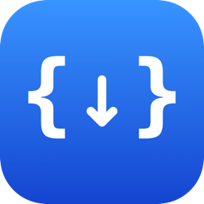
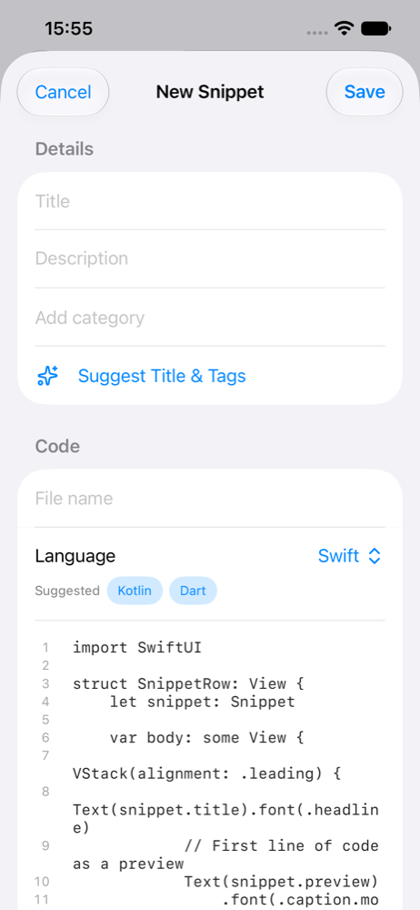
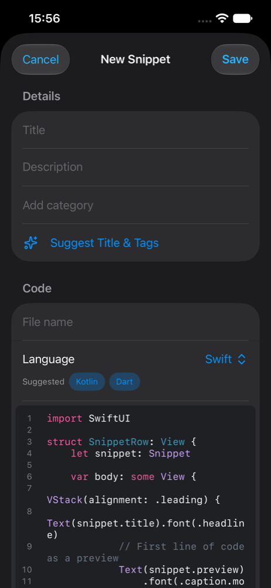
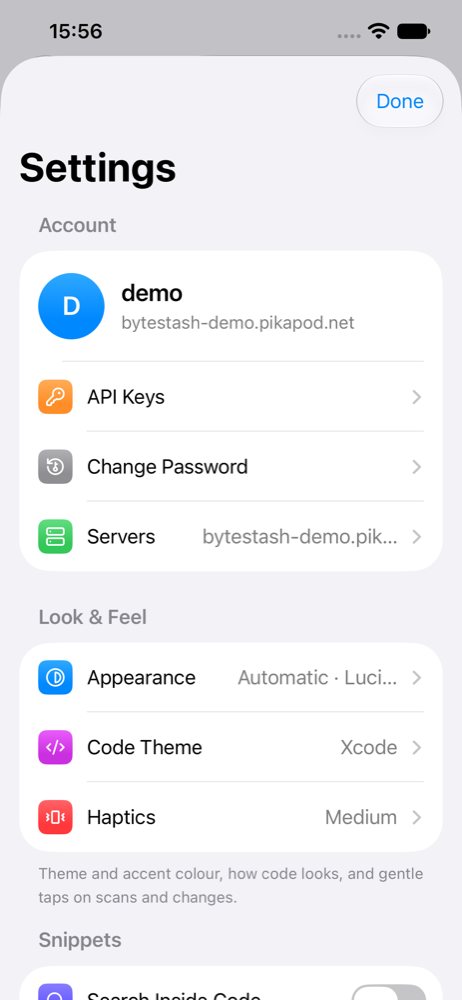
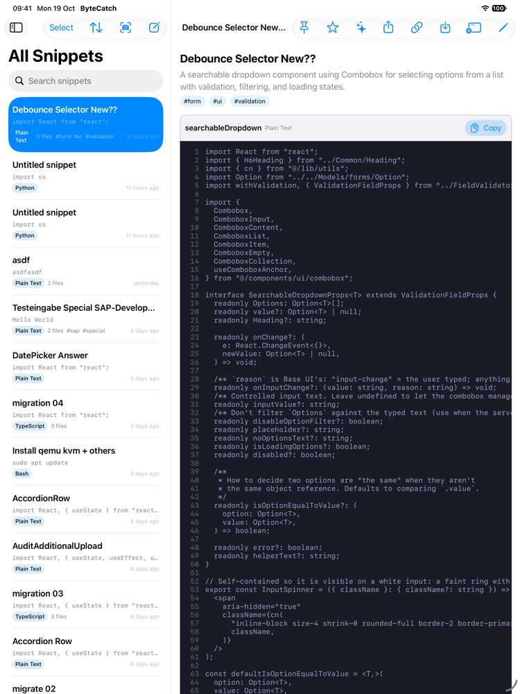

<p align="center">
  
</p>

<h1 align="center">ByteCache</h1>

<p align="center"><strong>Cache the bytes.</strong></p>

<p align="center">
  A native iPhone, iPad and Mac client for <a href="https://github.com/jordan-dalby/ByteStash">ByteStash</a>, the self-hosted code snippet manager.<br>
  Catch code from anywhere, find it again, and copy it in one tap.
</p>

<p align="center">
  
  
  
  
  <a href="LICENSE"></a>
</p>

<p align="center">
  
  
  
</p>
<p align="center">
  
</p>

> ByteCache is an independent, unofficial app. It is not affiliated with the ByteStash project, talks only to ByteStash's HTTP API and contains no ByteStash code.

## Features

**Capture**
- Share sheet from Safari or any app: select code → Share → ByteCache
- Save what's on the clipboard from Control Center, the Lock Screen, the Action Button or Siri
- Scan code with the camera or from a photo or screenshot, on the device
- Saved while offline? It uploads by itself when you're back online
- Warns before you save something that looks like a password or API key

**Find and use**
- On-device language detection (rules plus a Core ML model, 94% top-1)
- Search, filter by language or category, pinned, favourites, most used, recycle bin
- Syntax highlighting in 22 editor themes (GitHub, Dracula, Monokai, Nord, …) and an icon for each language
- Copy any file in one tap, save it as a file with the right extension, or share a link with a QR code
- Widgets, Spotlight, Shortcuts, Handoff, and a Markdown preview

**Edit**
- A real code editor: live colouring, line numbers, auto-indent, auto-closing brackets, matching-bracket highlight, find and replace
- Multi-file snippets, categories, public snippets, bulk actions
- Title and tag suggestions and "Explain this snippet" with Apple Intelligence (iOS / macOS 26)

**Yours**
- Several servers, password or API-key login, App Lock with Face ID or Touch ID
- Backup to ZIP or JSON; import from GitHub Gists, VS Code snippet files and folders of code
- iCloud sync of settings and your server list (never logins or code)
- Same features on iPhone, iPad and Mac (native macOS, not Catalyst)

## Download

Builds for iPhone, iPad and Mac are on the [Releases](../../releases) page. They're unsigned: on iPhone and iPad, sideload the `.ipa` with Sideloadly or AltStore; on Mac, unzip the app and right-click → Open the first time.

## Requirements

- A [ByteStash](https://github.com/jordan-dalby/ByteStash) server (tested with v1.6), or the public demo to try it out
- iOS / iPadOS 17 or later, macOS 14 or later; some features need iOS / macOS 18 or 26

## Build

You need Xcode 27 or later and [XcodeGen](https://github.com/yonaskolb/XcodeGen) (`brew install xcodegen`).

```sh
git clone https://github.com/js-surya/bytecache.git
cd bytecache
cp Config/Signing.xcconfig.example Config/Signing.xcconfig   # put your Apple Team ID in it
open ByteCache.xcodeproj
```

To try it without your own server, tap **Try the demo server** on the first screen. It's public, so don't save real code there.

Run all the tests and both builds:

```sh
scripts/test.sh
```

## Project layout

| Path | What's there |
|---|---|
| `Packages/ByteCacheKit` | All the logic, as a Swift package: `ByteCacheCore` (API, login, cache, offline queue), `ByteCacheLanguage` (language detection), `ByteCacheFeatures` (view models and shared SwiftUI views) |
| `App/` | The thin app target for iOS and macOS |
| `ShareExtension-iOS/`, `ShareExtension-macOS/`, `Widgets/` | Extensions |
| `Tools/LanguageModelTrainer` | Reproducible training of the language model ([data sources and licences](Packages/ByteCacheKit/Sources/ByteCacheLanguage/DATA.md)) |
| `docs/` | Design, plans, [privacy policy](docs/PRIVACY.md) and the [parity checklist](docs/PARITY_CHECKLIST.md) |

## Privacy

ByteCache collects no data: no analytics, tracking or ads, and no ByteCache server. Your snippets only go to the ByteStash server you choose. Language detection, scanning and suggestions run on your device. Details are in the [privacy policy](docs/PRIVACY.md).

## Contributing

Bug reports and ideas are welcome. Please use the [issue forms](../../issues/new/choose). See [CONTRIBUTING.md](.github/CONTRIBUTING.md) before opening a pull request.

## Credits

By [SyntaxError](https://github.com/js-surya).

Uses [HighlightSwift](https://github.com/appstefan/HighlightSwift) (MIT), [highlight.js](https://highlightjs.org) (BSD-3-Clause), [Lucide](https://lucide.dev) icons (ISC) and [Devicon](https://devicon.dev) language logos (MIT; the logos are trademarks of their owners). The colour palettes belong to their authors. The language model was trained on permissively licensed open-source code, and the test set contains short excerpts from it; [DATA.md](Packages/ByteCacheKit/Sources/ByteCacheLanguage/DATA.md) lists every source with its licence.

## Licence

The code is under the [MIT License](LICENSE). The ByteCache name and app icon are not covered by it: if you publish your own build, please use a different name and icon.

Report security problems privately; see [SECURITY.md](.github/SECURITY.md). Everyone taking part follows the [code of conduct](.github/CODE_OF_CONDUCT.md).
